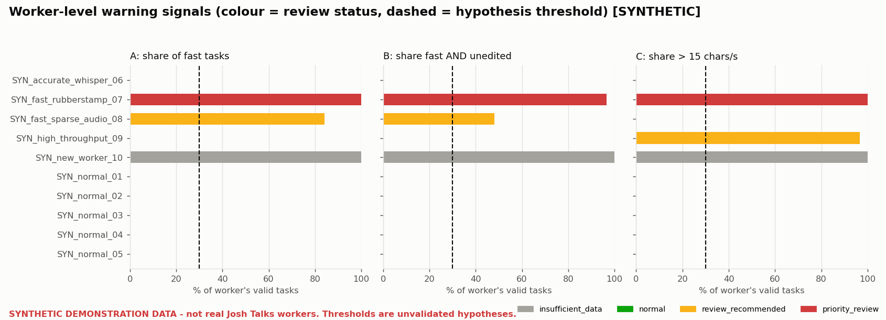
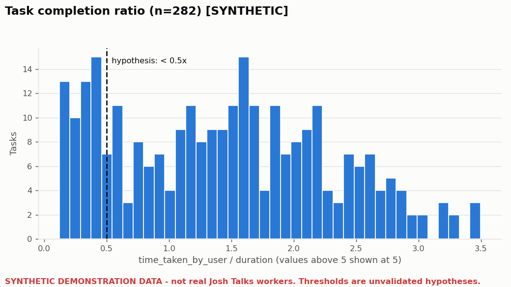

# Josh Talks AI Product Task

### Detecting potentially low-quality reviewers of Whisper-generated Hindi transcripts

An interpretable, rules-based screening pipeline. It finds transcription reviewers whose **repeated** behaviour suggests they may be accepting AI output without really checking it, and routes them to **human quality review**. It does not decide that anyone is low quality, and it never suspends or blocks accounts.

> ### ⚠️ Data status: please read
> The real Josh Talks worker-performance dataset was **not available** when this project was built. **No real workers have been analysed or identified.**
> - The pipeline is ready to run on the real export (`--input your_file.csv`).
> - Everything in `outputs/synthetic_demo/` comes from a **synthetic, in-memory dataset** of fictional workers. It is labelled `SYNTHETIC` in every file name, every CSV row and every chart.
> - Every threshold is an **unvalidated starting hypothesis** and must be calibrated on real data.

---

## Table of contents
1. [The problem](#1-the-problem)
2. [The solution at a glance](#2-the-solution-at-a-glance)
3. [Repository structure](#3-repository-structure)
4. [How to run the project](#4-how-to-run-the-project)
5. [Input data format](#5-input-data-format)
6. [How the analysis works](#6-how-the-analysis-works)
7. [Configuration (all thresholds)](#7-configuration-all-thresholds)
8. [Outputs and how to read them](#8-outputs-and-how-to-read-them)
9. [Synthetic demonstration results](#9-synthetic-demonstration-results)
10. [Tests](#10-tests)
11. [Optional Streamlit dashboard](#11-optional-streamlit-dashboard)
12. [Troubleshooting](#12-troubleshooting)
13. [Known limitations](#13-known-limitations)
14. [Further documentation](#14-further-documentation)

---

## 1. The problem
Josh Talks collects Hindi conversational speech. Whisper produces a first-draft transcript, and paid human reviewers listen to the audio and correct it. A reviewer who clicks "accept" without listening looks productive, but:
- **Data quality suffers:** Whisper's errors become "ground truth" in training data.
- **Money is wasted:** the company pays for reviews that added nothing.
- **Fairness matters:** good, fast reviewers must not be wrongly penalised.

## 2. The solution at a glance
Three warning signals, computed from fields the platform already logs:

| Signal | Formula | Provisional trigger *(hypothesis)* |
|---|---|---|
| **A: Fast completion** | `time_taken_by_user / duration` | ratio < 0.5 on ≥30% of a worker's tasks (min. 3 tasks) |
| **B: Unedited acceptance** | share of tasks with `is_edited = No` | ≥90% unedited **AND** ≥30% of tasks both fast and unedited |
| **C: High throughput** | non-space chars in `user_text` / `time_taken_by_user` | >15 chars/s on ≥30% of tasks, **OR** peer outlier (MAD robust z ≥ 3.5) |

Each worker receives one status, with written reasons:

| Status | Meaning | Recommended action |
|---|---|---|
| `insufficient_data` | fewer than 10 tasks with valid timing | keep collecting, no action |
| `normal` | no repeated warning pattern | none |
| `review_recommended` | 1 signal | blind-sample 5–10 transcripts for QA |
| `priority_review` | 2+ signals | prioritise sampled QA; **no account action without reviewer evidence** |

Key safeguard: **a high no-edit rate on its own is never flagged.** Whisper is often simply correct.

## 3. Repository structure
```text
.
├── analysis.py              # Pipeline + command-line interface (all logic lives here)
├── dashboard.py             # Optional Streamlit dashboard (read-only)
├── tests/
│   └── test_analysis.py     # 36 automated pytest tests
├── outputs/
│   ├── .gitkeep             # real-data outputs are written here
│   └── synthetic_demo/      # SYNTHETIC_* demo CSVs and charts
├── report.md                # Full product & analysis report (10 sections)
├── summary.md               # One-page executive summary
├── system_design.md         # Production workflow, Mermaid diagram, schema, APIs, governance
├── requirements.txt         # Python dependencies
├── LICENSE                  # Apache 2.0
└── README.md
```

## 4. How to run the project

### 4.1 Prerequisites
- **Python 3.10 or newer** (tested on Python 3.12)
- `git`
- About 200 MB of disk space for dependencies (more if you install Streamlit)

Check your Python version:
```bash
python --version
```

### 4.2 Clone the repository
```bash
git clone https://github.com/HaRsH00000007/Josh_talks.git
cd Josh_talks
```

### 4.3 Create a virtual environment (recommended)
**Windows (PowerShell)**
```powershell
python -m venv .venv
.\.venv\Scripts\Activate.ps1
```
If PowerShell blocks the activation script, run this once: `Set-ExecutionPolicy -Scope CurrentUser RemoteSigned`

**Windows (Command Prompt)**
```cmd
python -m venv .venv
.venv\Scripts\activate.bat
```

**macOS / Linux**
```bash
python3 -m venv .venv
source .venv/bin/activate
```

### 4.4 Install dependencies
```bash
pip install -r requirements.txt
```
This installs `pandas`, `numpy`, `matplotlib` and `pytest`.

### 4.5 Run the synthetic demonstration (no data needed)
```bash
python analysis.py --synthetic-demo
```
This builds a fictional dataset **in memory** and writes labelled outputs to `outputs/synthetic_demo/`. Expected console output (abridged):
```text
========================================================================
DATA SOURCE: SYNTHETIC - NOT REAL JOSH TALKS DATA
!! These results describe SYNTHETIC test workers, not real Josh Talks transcribers. !!
========================================================================
Rows in: 287 | after cleaning: 285 | duplicates removed: 2 | missing user_id removed: 0
...
Workers analysed: 10
  insufficient_data    1
  normal               6
  review_recommended   2
  priority_review      1
  -> SYN_fast_rubberstamp_07 [priority_review]: A: 30/30 tasks (100%) finished in < 0.5x audio length ...
Flags mean 'sample for human review'. No automatic account action is implied.
```

### 4.6 Run on the real dataset
```bash
python analysis.py --input path/to/worker_tasks.csv
```
Outputs are written to `outputs/`. To write somewhere else:
```bash
python analysis.py --input path/to/worker_tasks.csv --output-dir results/2026-10
```
Skip the charts (faster, e.g. in a scheduled job):
```bash
python analysis.py --input path/to/worker_tasks.csv --no-plots
```

### 4.7 Change thresholds without editing code
Every threshold can be overridden on the command line:
```bash
python analysis.py --input data.csv --min-valid-tasks 20 --fast-ratio-threshold 0.4 --char-rate-threshold 18
python analysis.py --help        # lists every parameter and its default
```

### 4.8 Exit codes
| Code | Meaning |
|---|---|
| `0` | Success |
| `2` | No input given, file not found, unparseable file, missing columns, or no usable rows. The message explains how to fix it. |

## 5. Input data format
One row per transcription task. Required columns (matched case-insensitively, surrounding spaces ignored):

| Column | Type | Description |
|---|---|---|
| `user_id` | string | Reviewer identifier |
| `recording_url` | string | Audio segment link |
| `whisper_text` | string | Whisper's draft transcript |
| `user_text` | string | Reviewer's final transcript |
| `is_edited` | Yes/No, True/False, 1/0 | Whether the reviewer edited the draft |
| `duration` | number (s) | Audio segment length |
| `time_taken_by_user` | number (s) | Time the reviewer spent |
| `segment_character_per_second` | number | Defined in the task as non-space characters in user_text ÷ time_taken_by_user (checked by the script against both worker time and audio duration) |

Supported formats: **CSV** (primary, UTF-8 or UTF-8 with BOM), TSV, JSON/JSONL, and XLSX (`pip install openpyxl` first).

Minimal example:
```csv
user_id,recording_url,whisper_text,user_text,is_edited,duration,time_taken_by_user,segment_character_per_second
w_001,https://.../a.wav,आपका दिन कैसा रहा,आपका दिन कैसा रहा,No,2.1,4.3,6.2
w_001,https://.../b.wav,हम बाज़ार गए थे,हम बाजार गए थे,Yes,1.8,5.0,6.7
```

## 6. How the analysis works
```text
load → validate columns → clean → task-level indicators → worker aggregation → risk rules → CSVs + charts + console summary
```

**Cleaning (nothing is dropped silently; everything is counted in the data-quality report)**
- Exact duplicate rows are removed. Rows without `user_id` are removed.
- Non-numeric, infinite, zero or negative `duration` / `time_taken_by_user` values are kept in the counts but **excluded from ratios**, so no divide-by-zero can occur.
- `is_edited` is normalised: Yes/Y/True/T/1 → True; No/N/False/F/0 → False; anything else → *unknown*, never silently treated as "No".
- Text is Unicode-NFC normalised. Devanagari vowel signs count as characters.

**Task-level indicators**
- `completion_ratio`, `is_fast_task`
- `text_similarity` (character-level, `difflib`), `material_change` (similarity < 0.90)
- `edit_flag_consistency`: flags rows where `is_edited` contradicts the actual text diff (a **data-quality** issue, not counted against the worker)
- `char_rate`, `is_high_rate_task`
- Checks of the supplied `segment_character_per_second` against the defined calculation (chars ÷ time taken) and an audio-duration alternative (chars ÷ audio duration), reporting which calculation it matches

**Worker aggregation:** every metric is stored with its **denominator** (`n_valid_timing`, `n_edit_flag_known`, `n_text_comparable`, `n_valid_char_rate`), so it is always clear how much evidence a number rests on.

**Risk scoring:** `risk_score = wA·A + wB·B + wC·C` (default weights 1). Score ≥1 → `review_recommended`, score ≥2 → `priority_review`. Workers below the minimum sample size get `insufficient_data` whatever their score, with any provisional signals still listed in the reasons.

**Note on independence:** A and C both divide by `time_taken_by_user`, so they are correlated. C adds a correction for speech density: fast work on a mostly silent clip trips A but not C. The only truly independent evidence is human review of sampled transcripts, which is why flags lead only to review.

## 7. Configuration (all thresholds)
All values live in the `Config` dataclass at the top of `analysis.py`. Every one can be overridden with the CLI flag shown.

| Parameter | CLI flag | Default | Purpose |
|---|---|---|---|
| `min_valid_tasks` | `--min-valid-tasks` | 10 | Tasks needed before any status |
| `min_repeated_tasks` | `--min-repeated-tasks` | 3 | Minimum suspicious tasks for a signal |
| `min_workers_for_mad` | `--min-workers-for-mad` | 5 | Peers needed for the MAD outlier test |
| `fast_ratio_threshold` | `--fast-ratio-threshold` | 0.5 | A: ratio below this = fast task |
| `fast_share_threshold` | `--fast-share-threshold` | 0.30 | A: share of fast tasks |
| `no_edit_share_threshold` | `--no-edit-share-threshold` | 0.90 | B: high no-edit share |
| `fast_unedited_share_threshold` | `--fast-unedited-share-threshold` | 0.30 | B: corroboration share |
| `material_similarity_threshold` | `--material-similarity-threshold` | 0.90 | Text similarity below this = material change |
| `char_rate_threshold` | `--char-rate-threshold` | 15.0 | C: chars/s per task |
| `high_rate_share_threshold` | `--high-rate-share-threshold` | 0.30 | C: share of high-rate tasks |
| `mad_z_threshold` | `--mad-z-threshold` | 3.5 | C: peer robust z-score |
| `cps_relative_tolerance` | `--cps-relative-tolerance` | 0.20 | Tolerance when checking the supplied cps field |
| `weight_a` / `weight_b` / `weight_c` | `--weight-a` … | 1 | Signal weights |
| `review_score` / `priority_score` | `--review-score` / `--priority-score` | 1 / 2 | Status cut-offs |

The thresholds used in each run are saved to `config_used.csv` for audit.

## 8. Outputs and how to read them
Real-data runs write to `outputs/`. Synthetic runs write to `outputs/synthetic_demo/` with a `SYNTHETIC_` prefix.

| File | Contents |
|---|---|
| `worker_risk_summary.csv` | One row per worker: metrics with denominators, `signal_a_fast`, `signal_b_unedited_corroborated`, `signal_c_high_throughput`, `risk_score`, `review_status`, `reasons`, `notes`, `recommended_action`, `data_source` |
| `task_level_metrics.csv` | One row per task with every computed indicator |
| `data_quality_report.csv` | Duplicates, invalid values, unrecognised `is_edited`, missing text, flag/text contradictions, which definition `segment_character_per_second` matches |
| `config_used.csv` | Exact thresholds used |
| `completion_ratio_distribution.png` | Histogram of task completion ratios, with the hypothesis threshold |
| `char_rate_distribution.png` | Histogram of characters per second, with the hypothesis threshold |
| `worker_signal_comparison.png` | Per-worker share of tasks for each signal, coloured by status |
| `workers_by_review_status.png` | Count of workers per status |

**Reading a row:**
- `reasons` quotes the evidence, e.g. `A: 21/25 tasks (84%) finished in < 0.5x audio length (median ratio 0.38)`.
- `notes` holds non-risk information, e.g. `High no-edit share (97%) without fast-completion corroboration - not flagged`.
- `data_source` is always either `REAL - user-supplied dataset` or `SYNTHETIC - NOT REAL JOSH TALKS DATA`.

Charts are skipped automatically when there are no valid values to plot, so empty or misleading charts are never produced.

## 9. Synthetic demonstration results
> **SYNTHETIC: fictional workers built to exercise the logic. Not evidence about real Josh Talks reviewers.**

| Synthetic profile | Status | Why |
|---|---|---|
| `SYN_fast_rubberstamp_07`: fast and never edits | `priority_review` | A + B + C |
| `SYN_fast_sparse_audio_08`: fast on mostly silent audio | `review_recommended` | A only; C correctly not triggered (human review should clear this worker) |
| `SYN_high_throughput_09`: dense speech, 0.55–0.9× speed | `review_recommended` | C only |
| `SYN_accurate_whisper_06`: 97% unedited, normal timing | `normal` | B not flagged without corroboration |
| `SYN_new_worker_10`: 4 tasks | `insufficient_data` | below minimum sample |
| `SYN_normal_01…05` | `normal` | no repeated pattern |




## 10. Tests
```bash
python -m pytest -q
# 36 passed
```
The tests cover missing columns, empty datasets, invalid and zero durations, missing text, zero or missing time taken, `is_edited` normalisation, character-rate calculation (including Devanagari), duplicate removal, worker aggregation and denominators, the minimum-sample-size rule, risk-status assignment, configurable thresholds, the absence of blocking/suspension language, synthetic-versus-real labelling, CLI error handling, and chart skipping for invalid data.

All test fixtures are synthetic and built in memory.

## 11. Optional Streamlit dashboard
```bash
pip install streamlit
streamlit run dashboard.py
```
Your browser opens at `http://localhost:8501`. In the sidebar:
- **Upload real CSV:** analyse the real export, or
- **Synthetic demo (not real data):** shows a red "SYNTHETIC" banner.

The dashboard shows worker counts by status, signal distributions, the flagged-worker table with reasons, a task-level drill-down (Whisper text versus final text) and the data-quality report. Thresholds can be adjusted live. It is **read-only** and has no account-action controls.

## 12. Troubleshooting
| Problem | Fix |
|---|---|
| `ModuleNotFoundError: No module named 'pandas'` (or matplotlib) | Activate the virtual environment, then run `pip install -r requirements.txt` |
| `ERROR: Dataset is missing required column(s): ...` | Rename the columns to match [§5](#5-input-data-format). The error lists both expected and found columns. |
| `ERROR: Could not parse ...` | The file is malformed (e.g. an unclosed quote). Re-export it as UTF-8 CSV. |
| Hindi text appears garbled in Excel | The outputs are UTF-8 with BOM. Open them via Excel → Data → From Text/CSV and choose UTF-8. |
| `.xlsx` input fails | `pip install openpyxl` |
| Many workers are `insufficient_data` | Use a longer data window, or lower `--min-valid-tasks` with care |
| PowerShell will not activate the venv | `Set-ExecutionPolicy -Scope CurrentUser RemoteSigned` |

## 13. Known limitations
- **No real data has been analysed.** All thresholds (0.5×, 90%, 15 chars/s, 30% shares, z ≥ 3.5, n ≥ 10) are hypotheses.
- All three signals are behavioural proxies that rely on `time_taken_by_user`. None measures accuracy directly.
- Legitimate fast playback, very short clips, silent audio and incomplete timing logs can all cause false alarms. This is why flags lead only to review.
- While `segment_character_per_second` is defined in the task as characters ÷ worker time, data export implementations can vary. The script independently verifies whether the supplied field matches that definition or an audio-duration alternative.
- Text similarity is character-level and does not weight edits by importance.
- No machine-learning classifier is used, because there are no reliable labelled outcomes yet. The validation plan is in `report.md` §10.

## 14. Further documentation
- [`summary.md`](summary.md): one-page executive summary
- [`report.md`](report.md): full report covering problem, signals, risk logic, false-positive safeguards, workflow, engineering recommendations and validation plan
- [`system_design.md`](system_design.md): production workflow (Mermaid flowchart), output schema, API and database boundaries, privacy, access control, audit, threshold calibration and appeals

## License
Apache License 2.0. See [LICENSE](LICENSE).
