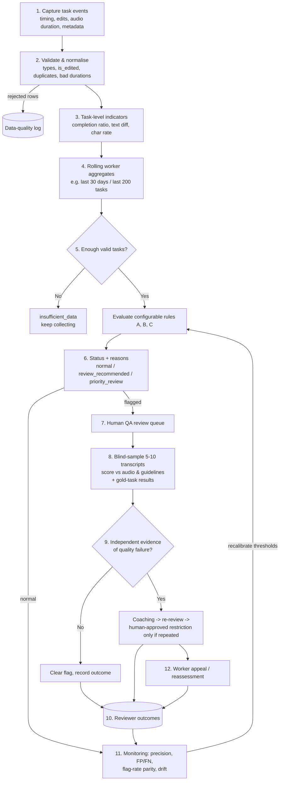

# System Design: Automated Reviewer-Quality Screening

**Scope:** the proposed production workflow for the Question 2 detection logic. `analysis.py` implements steps 2–6 as a batch job. The other steps are product and process design, described here but deliberately not built as a backend.

**Principle:** automation *prioritises* what humans look at. It never *decides* what happens to a worker.

## 1. End-to-end flow



## 2. Step detail

| # | Step | Key decisions |
|---|---|---|
| 1 | **Capture** | Log `time_taken_by_user` plus *active listening time*, play/seek/replay events, playback speed, client timestamps, device, audio-batch ID. |
| 2 | **Validate & normalise** | Required-column check; `is_edited` Yes/No/True/False/1/0 → boolean, otherwise unknown; non-positive or non-numeric durations excluded from ratios but counted; exact duplicates dropped; every rejection counted in a data-quality log. |
| 3 | **Task indicators** | `completion_ratio`, `text_similarity`, `material_change`, edit-flag consistency, `char_rate`, consistency check on the supplied `segment_character_per_second`. |
| 4 | **Rolling aggregates** | Configurable window (default: last 30 days, capped at 200 tasks). Every metric stored with its denominator. |
| 5 | **Rules** | Versioned `Config` (thresholds, minimum counts, weights). Peer MAD baseline computed within the same window, ideally within segment-length bands. |
| 6 | **Status & reasons** | Four statuses; human-readable reasons with counts; informational notes kept separate from risk reasons. |
| 7 | **Review queue** | Priority first, then by risk score and volume. SLA for example 5 working days. Reviewers see the reasons but not other reviewers' verdicts. |
| 8 | **Sampling** | Stratified random sample of 5–10 tasks; reviewer listens and scores against the transcription guidelines (CER/WER against a corrected reference, plus a rubric). Gold-task results attached when available. |
| 9 | **Escalation** | Requires confirmed quality failures in the sample (e.g. CER above an agreed bar on ≥N tasks). First step is coaching and re-review. Any restriction needs a second human approver and a documented evidence pack. |
| 10 | **Outcomes** | Structured verdicts: `confirmed_low_quality`, `cleared`, `inconclusive`, plus a reason code. These become the labelled data for calibration. |
| 11 | **Monitoring** | Precision per status, false-positive rate (cleared ÷ flagged), estimated false negatives from random audits of unflagged workers, flag-rate parity across worker segments, drift in metric distributions. |
| 12 | **Appeals** | Worker sees the status, the reasons in plain language and the sampled evidence. Can request reassessment by a different reviewer, who decides within an SLA. |

## 3. Example worker-level output schema

| Field | Type | Example | Notes |
|---|---|---|---|
| `data_source` | string | `REAL - user-supplied dataset` | `SYNTHETIC - NOT REAL JOSH TALKS DATA` for demos |
| `user_id` | string | `w_10293` | pseudonymous ID |
| `window_start` / `window_end` | date | 2026-09-01 / 2026-09-30 | production only |
| `n_tasks_total` | int | 182 | |
| `n_valid_timing` | int | 176 | denominator for A |
| `median_completion_ratio` | float | 0.41 | |
| `n_fast_tasks` / `pct_fast_tasks` | int / float | 88 / 0.50 | |
| `n_edit_flag_known` / `n_unedited` / `pct_unedited` | int / int / float | 182 / 170 / 0.93 | denominator for B |
| `n_fast_and_unedited` / `pct_fast_and_unedited` | int / float | 85 / 0.48 | corroboration for B |
| `n_text_comparable` / `n_material_change` | int / int | 180 / 6 | |
| `n_edit_flag_inconsistent` | int | 2 | data quality, not risk |
| `n_valid_char_rate` / `median_char_rate` / `p90_char_rate` | int / float / float | 176 / 17.2 / 29.0 | denominator for C |
| `n_high_rate_tasks` / `pct_high_rate_tasks` | int / float | 101 / 0.57 | |
| `char_rate_robust_z` / `mad_baseline_workers` | float / int | 4.1 / 312 | |
| `signal_a_fast`, `signal_b_unedited_corroborated`, `signal_c_high_throughput` | bool | true, true, true | |
| `risk_score` | int | 3 | |
| `review_status` | enum | `priority_review` | |
| `reasons` | string | `A: 88/176 tasks (50%) ...` | shown to reviewers and, in plain form, to the worker |
| `notes` | string | | informational |
| `recommended_action` | string | `Prioritise sampled quality review; no account action without reviewer evidence` | |
| `config_version` | string | `rules-v0.3` | production only |

## 4. Suggested service and database boundaries (not implemented)

```
[Transcription app] --events--> [Task event store] --nightly batch--> [Quality-signal job (analysis.py logic)]
                                                                      |
                                                    writes            v
                                     [worker_quality_snapshot]   [task_quality_metrics]
                                                                      |
                                    [QA review service] <--- reads ---+
                                          | writes
                                          v
                                  [review_outcome] ---> [calibration notebook / monitoring dashboard]
```

**Tables:** `task_event` (raw, append-only) · `task_quality_metrics` (one row per task per run) · `worker_quality_snapshot` (one row per worker per window and config version) · `review_case` / `review_outcome` · `appeal` · `rule_config` (versioned).

**APIs (internal only):**
- `GET /quality/workers/{user_id}/snapshot?window=30d`: latest status, reasons, metrics.
- `GET /quality/review-queue?status=priority_review`: QA reviewers only.
- `POST /quality/review-cases/{id}/outcome`: reviewer verdict with evidence links.
- `POST /quality/appeals`: raised by the worker. `POST /quality/appeals/{id}/decision`: second reviewer.
- There is **no** endpoint that changes account standing. Account actions stay in the existing workforce-management system and require a linked, confirmed `review_outcome`.

## 5. Logging, privacy, access control and audit

- **Audit trail:** each snapshot records the input data window, row counts, data-quality summary, `config_version` and code version, so any status can be reproduced exactly.
- **Immutable decisions:** review outcomes and appeal decisions are append-only, with reviewer ID and timestamp.
- **Privacy:** use pseudonymous `user_id`s in analytics. Restrict access to audio and transcripts, because they contain personal speech. Do not export raw text into dashboards beyond what an investigation needs. Apply retention limits to snapshots. Follow the DPDP Act (India) and the contractual terms with workers.
- **Access control (RBAC):** analysts see aggregates; QA reviewers see assigned cases and their audio; ops leads see outcomes; workers see only their own status, reasons and evidence.
- **Transparency to workers:** publish the categories of signals used in quality monitoring.

## 6. Threshold calibration and feedback loop

1. **Bootstrap:** start with the hypothesis thresholds and run in **shadow mode**. Statuses are computed but trigger only sampling, never consequences.
2. **Distribution check:** after the first real run, compare the hypotheses with the observed percentiles, stratified by segment length (e.g. under 2 s, 2–5 s, over 5 s), because short Hindi conversational segments have large fixed overheads.
3. **Labelled outcomes:** for 4–6 weeks, review every priority case, a sample of review-recommended cases **and a random sample of normal workers**. Without the last group, false negatives cannot be estimated.
4. **Tune:** choose thresholds and weights that hit an agreed precision target (e.g. ≥70% of priority cases confirmed) at an acceptable reviewer workload. Publish each change as a new `config_version`.
5. **Guardrails:** alert if flag rates shift sharply after a release (a sign of a logging bug, not a change in workers), or if flag rates differ markedly across worker segments.
6. **Graduate:** once there are several hundred labelled outcomes, test a simple, interpretable model (e.g. logistic regression on the same features) against the rules, and adopt it only if it improves precision and recall without hurting fairness.
